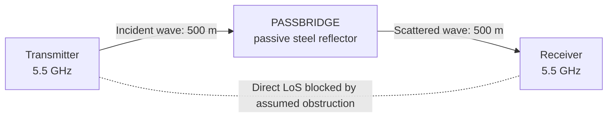
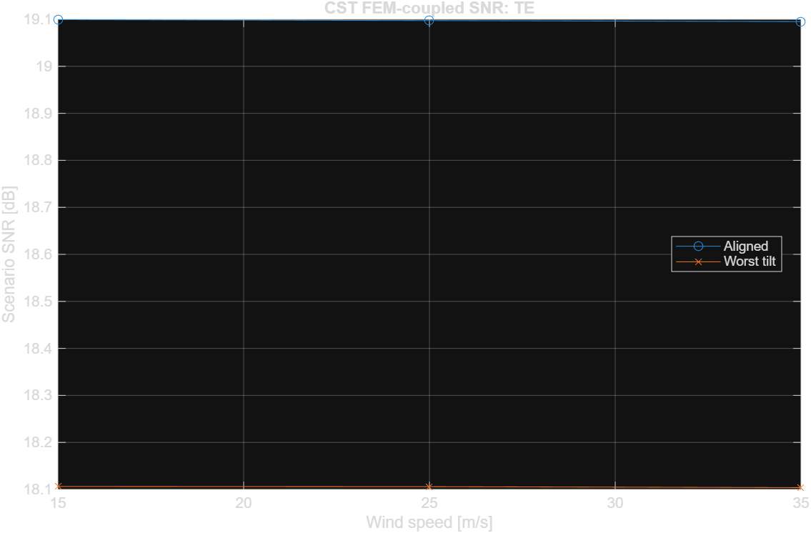
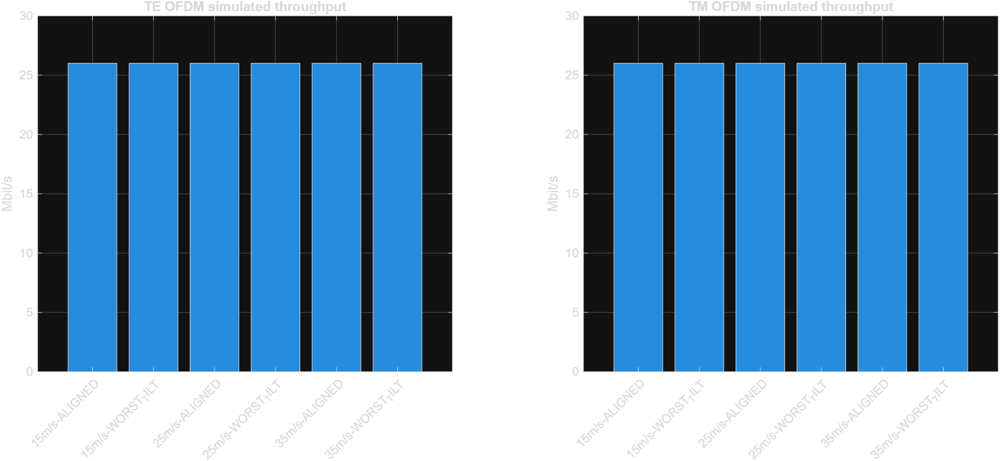

# PASSBRIDGE
### Passive Microwave Reflector for 5.5 GHz Non-Line-of-Sight Communication

**Integrated electromagnetic, structural, and digital communication simulation study**  
**Designed and developed by Cem Sondur** · October 2026 · **Research status: Numerical feasibility study**

> **Scope of evidence.** PASSBRIDGE investigates an unpowered, finite-conductivity microwave reflector as a means of redirecting an otherwise obstructed wireless link. This repository contains the native CST and COMSOL models, the archived structural and scattered-field data, results of 75 CST geometry cases (150 TE/TM records), MATLAB QPSK-OFDM simulations, and the corresponding processing sources. Results are conditional numerical predictions—not field measurements, structural certification, or a deployed communications product.

| Key parameter | Modeled value or recorded result |
|:--|:--|
| Operating frequency | **5.5 GHz** |
| Reflector aperture | **Approximately 2 × 2 m** |
| Material | **DX51D+Z275 galvanized steel**, finite-conductivity approximation |
| Nominal propagation path | **500 m + 500 m**, 90° redirection |
| CST conditions | **3 wind scenarios × 5 × 5 pointing combinations = 75** |
| Scattered-field records | **150 complex TE/TM exports** |
| Most adverse calculated received power | **−75.9011 dBm** |
| Primary scenario power screen | **−77 dBm**; calculated minimum margin ≈ **1.10 dB** |
| Communications model | **20 MHz, uncoded 64-point QPSK-OFDM / AWGN** |
| Modeled PHY-derived payload rate | **26 Mbit/s**, not measured throughput |

## Table of contents

1. [Project objective and engineering contribution](#1-project-objective-and-engineering-contribution)
2. [System concept and operating principle](#2-system-concept-and-operating-principle)
3. [Mechanical geometry and materials](#3-mechanical-geometry-and-materials)
4. [Electromagnetic and link-budget theory](#4-electromagnetic-and-link-budget-theory)
5. [Multiphysics simulation workflow](#5-multiphysics-simulation-workflow)
6. [CST electromagnetic results](#6-cst-electromagnetic-results)
7. [COMSOL structural results](#7-comsol-structural-results)
8. [MATLAB communication results](#8-matlab-communication-results)
9. [Repository files and traceability](#9-repository-files-and-traceability)
10. [Reproducibility instructions](#10-reproducibility-instructions)
11. [Engineering interpretation and limitations](#11-engineering-interpretation-and-limitations)
12. [References, authorship, and licensing](#12-references-authorship-and-licensing)

---

## 1. Project objective and engineering contribution

Direct line-of-sight (LoS) radio links can be interrupted by terrain, buildings, and unfavorable terminal placement. Active repeaters or new powered radio sites may not be desirable in every situation because they introduce hardware, energy, maintenance, and access requirements.

**PASSBRIDGE evaluates a passive alternative:** a physically sized metallic panel that redirects incident microwave energy toward a receiver which cannot directly see the transmitter. The reflector itself has no RF amplifier, local oscillator, frequency conversion, or external energy demand. **The transmitting and receiving radios still require power.**

The investigation addresses four coupled engineering questions:

- **Electromagnetic behavior:** What is the bistatic radar cross section (RCS) of the finite-conductivity reflector at 5.5 GHz, and how does it vary with polarization and pointing?
- **Structural behavior:** How does the supported sheet-and-frame assembly deflect under simplified static wind loading?
- **Electromechanical coupling:** How do calculated COMSOL surface displacements propagate into the CST scattering model, and how sensitive is the resulting link to ±0.2° pointing offsets?
- **Communications behavior:** Given the resulting conditional receiver SNR, what does an idealized, uncoded QPSK-OFDM baseband link exhibit in a finite Monte Carlo simulation?

The engineering contribution is the **traceable chain from structural displacement through physical reflector surface reconstruction and native electromagnetic field data to RF link assessment and baseband simulation**. Rather than replacing this chain with assumed reflector efficiency or arbitrary received-power figures, the deposited results retain the original polarization-resolved field samples.

## 2. System concept and operating principle

The reference study considers **two approximately 500 m radio segments**: transmitter to reflector and reflector to receiver. The reflector is oriented for a nominal **90° change in propagation direction**. The direct transmitter-to-receiver path is assumed obstructed, while both segments reaching the panel are assumed unobstructed.



**Figure 1 — Conceptual link geometry.** The figure is schematic and does not depict surveyed terrain, a physical site installation, or a propagation-measurement campaign.

The design does not amplify power. It redistributes incident electromagnetic energy according to the reflector geometry, conductivity, wavelength, polarization, and observation angle. The direct path can remain unavailable even if the two reflector paths are viable; this geometric requirement is a **scenario assumption** in the present study.

## 3. Mechanical geometry and materials

### 3.1 Surface and support structure

| Component | Modeled specification |
|:--|:--|
| Overall nominal aperture | Approximately **2000 × 2000 mm** |
| Reflecting panels | **Two 999 × 2000 mm** sheets |
| Center seam | **2 mm** |
| Steel substrate | **1.2 mm** nominal thickness |
| Steel grade and coating designation | **DX51D+Z275**, nominal |
| Perimeter structure | **Four 50 × 50 × 3 mm** rectangular hollow sections |
| Internal reinforcement | **Six 40 × 20 × 2 mm** rectangular hollow sections |
| Support boundary | **Four mounting pads / fixed support selections** |
| RF metal representation | Steel core plus front/back zinc layers; not a PEC surface |

The geometric model maintains separate sheet halves, a center discontinuity, a physically finite substrate, and a steel-profile support representation. The field and structural models are connected by exported displacement data rather than a visually chosen deformed shape.

### 3.2 Constitutive and coating assumptions

| Assumed input | Value | Interpretation |
|:--|--:|:--|
| Steel conductivity | 6.0 × 10⁶ S/m | Provisional electrical value |
| Zinc conductivity | 1.69 × 10⁷ S/m | Provisional electrical value |
| Relative permeability for RF estimate | 1 | Simplifying assumption |
| Zinc coating, each face | ≈19.3 µm | Equal-face equivalent based on Z275 nominal coating mass |
| Structural Young's modulus | 210 GPa | Nominal elastic response |
| Poisson's ratio | 0.30 | Nominal |
| Material density | 7850 kg/m³ | Nominal |

The **Z275** designation specifies an approximate total coating mass of **275 g/m² across both surfaces**; it does not guarantee the same local coating thickness everywhere. The per-face equivalent is only an estimate. Production coating properties, surface roughness, magnetic response, and connection stiffness were not measured in this numerical campaign. The structural sheet and frame use nominal elastic properties; actual weld and bolt stiffness and certified steel properties are separate engineering questions.

### 3.3 Microwave material rationale

At 5.5 GHz, a physically continuous metallic coating provides an electrically conductive scattering surface. Its quality and thickness matter at microwave frequencies because currents are concentrated near the conductor surface. Using **finite conductivities instead of PEC** avoids treating the modeled panel as an ideal lossless conductor. However, the assigned material values must not be mistaken for measurements of the actual galvanized sheet.

## 4. Electromagnetic and link-budget theory

### 4.1 Wavelength

The free-space wavelength at the design frequency is

```math
\lambda_0=\frac{c}{f}=\frac{299\,792\,458}{5.5\times10^9}\ \mathrm{m}\approx54.51\ \mathrm{mm}
```

<p align="right"><sub>(1) — Free-space wavelength at 5.5 GHz</sub></p>
Thus, the nominal 2 m reflector spans approximately **36.7 free-space wavelengths** along each side. This electrical size informs the choice of a high-frequency asymptotic scattering method.

### 4.2 Skin depth and surface impedance

For a homogeneous good conductor,

```math
\delta=\sqrt{\frac{2}{\omega\mu\sigma}}=\frac{1}{\sqrt{\pi f\mu\sigma}},\qquad\omega=2\pi f
```

<p align="right"><sub>(2) — Good-conductor skin depth</sub></p>
With the assumed conductivities and $\mu=\mu_0$, the estimated skin depths at 5.5 GHz are approximately **1.65 µm for zinc** and **2.77 µm for steel**. These are first-order planar-conductor estimates, not measured effective coating impedances.

An approximate good-conductor surface impedance is

```math
Z_s\simeq(1+j)\sqrt{\frac{\omega\mu}{2\sigma}}
```

<p align="right"><sub>(3) — Approximate surface impedance</sub></p>
### 4.3 Bistatic radar cross section

A passive reflector serving spatially separated transmitter and receiver antennas is assessed using **bistatic** scattering. In far-field form,

```math
\sigma_b=\lim_{R\to\infty}4\pi R^2\frac{|E_{\mathrm{scat}}|^2}{|E_{\mathrm{inc}}|^2}
```

<p align="right"><sub>(4) — Bistatic radar cross section</sub></p>
The released postprocessor operates on the specific normalization of the archived CST native complex-field export:

```math
\sigma_b=4\pi\left(|E_\phi|^2+|E_\theta|^2\right),\qquad\sigma_{\mathrm{dBsm}}=10\log_{10}(\sigma_b)
```

<p align="right"><sub>(5) — CST-export-dependent RCS calculation</sub></p>
**Normalization matters:** Equation (5) reflects the convention used in [DOGRULA_RCS.py](src/pipeline/DOGRULA_RCS.py); it should not be applied to arbitrary electric-field data without establishing the incident amplitude and far-field distance conventions.

The reported receiving direction is **$\theta=45^\circ,\phi=0^\circ$**. The maximum of the exported angular cut is retained as separate information; it is **not substituted** for the fixed receiver direction in the link budget.

### 4.4 Two-segment bistatic link budget

The scenario uses

```math
P_r=\frac{\mathrm{EIRP}\,G_r\,\lambda_0^2\,\sigma_b}{(4\pi)^3 R_1^2 R_2^2 L_{\mathrm{ext}}}
```

<p align="right"><sub>(6) — Two-segment bistatic received power (linear units)</sub></p>
where $\mathrm{EIRP}$ already incorporates transmit antenna gain, $G_r$ is the receiver antenna's linear gain, $R_1,R_2$ are the two distances, and $L_{\mathrm{ext}}$ is additional linear loss.

The equivalent calculation in decibel form is

```math
\begin{aligned}P_r[\mathrm{dBm}]={}&\mathrm{EIRP}[\mathrm{dBm}]+G_r[\mathrm{dBi}]+\sigma_{\mathrm{dBsm}}\\&+20\log_{10}(\lambda_0)-30\log_{10}(4\pi)\\&-20\log_{10}(R_1)-20\log_{10}(R_2)-L_{\mathrm{ext}}[\mathrm{dB}]\end{aligned}
```

<p align="right"><sub>(7) — Two-segment bistatic link budget (decibel units; distances in meters)</sub></p>
All lengths in Eq. (7) are expressed in **meters**.

| Assumed radio parameter | Value |
|:--|--:|
| Transmitter EIRP | 29 dBm |
| Receiver antenna gain | 23 dBi |
| Tx–reflector distance | 500 m |
| Reflector–Rx distance | 500 m |
| Additional loss | 6 dB |
| Channel bandwidth | 20 MHz |
| Receiver noise figure | 7 dB |

With room-temperature thermal noise approximated as −174 dBm/Hz,

```math
N[\mathrm{dBm}]\simeq-174+10\log_{10}(20\times10^6)+7=-93.99\ \mathrm{dBm}
```

<p align="right"><sub>(8) — Receiver noise power for 20 MHz and 7 dB noise figure</sub></p>
The listed SNR is calculated as $P_r-N$. None of these values establishes a measured receiver sensitivity or availability probability.

## 5. Multiphysics simulation workflow

| Stage | Software / numerical approach | Preserved output |
|:--|:--|:--|
| Structural analysis | **COMSOL Multiphysics 6.4**; three-dimensional solid mechanics | Displacement fields, stress and mesh metrics |
| Surface reconstruction | **Python**; FEM front-surface interpolation and 3D geometry export | Six metal solids per wind scenario and a provenance manifest |
| Electromagnetic analysis | **CST Studio Suite 2025**; shooting and bouncing rays (**SBR**) | Complex native polarization fields |
| RF verification | **Python**; RCS extraction and two-segment budget | Per-case RCS, received power and SNR |
| Baseband communication | **MATLAB R2025b**; QPSK-OFDM under flat AWGN | BER, packet-error observations and model rate |

### 5.1 Static wind-load scenarios

The simplified pressure model is

```math
p=\frac{1}{2}\rho_{\mathrm{air}}C_fV^2
```

<p align="right"><sub>(9) — Simplified static wind-pressure model</sub></p>
| Wind speed | Uniform applied pressure |
|--:|--:|
| 15 m/s | 248.0625 Pa |
| 25 m/s | 689.0625 Pa |
| 35 m/s | 1350.5625 Pa |

These are **illustrative static engineering scenarios**, not a code-prescribed, site-specific wind-design verification. Four modeled mounting pad selections receive fixed boundary conditions.

### 5.2 FEM-to-RF surface reconstruction

The solved COMSOL field exports actual **$u,v,w$** displacements. The front surface is reconstructed through eight-neighbor inverse-distance-weighted interpolation:

```math
\begin{aligned}\widehat{\mathbf u}(\mathbf x)&=\frac{\sum_{i=1}^{8}w_i(\mathbf x)\mathbf u_i}{\sum_{i=1}^{8}w_i(\mathbf x)}\\w_i(\mathbf x)&=\frac{1}{d_i^2+10^{-4}\,\mathrm{mm}^2}\end{aligned}
```

<p align="right"><sub>(10) — Eight-neighbor inverse-distance-weighted FEM interpolation</sub></p>
where $d_i$ denotes in-plane distance measured in millimeters; the $10^{-4}\,\mathrm{mm}^2$ regularizer follows the implementation in [FEMDEN_STL.py](src/pipeline/FEMDEN_STL.py). At an exactly coincident sample coordinate, the implementation uses that sample directly rather than the weighted average.

Each wind scenario produces **six closed finite-thickness metal solids**: core, front zinc, and back zinc for each of the two panel halves. The repository includes [three displacement tables](data/fem_displacement/) and [geometry manifests](data/geometry_provenance/), rather than 75 redundant full CST projects and intermediate caches.

The 35 m/s mesh-4 geometry manifest records **50,807 numeric FEM rows**, **12,815 front-surface rows**, a **41 × 41** reconstruction grid, and approximately **19.91 mm** maximum nearest-FEM-support distance. See the [35 m/s manifest](data/geometry_provenance/W35/FEM_GEOMETRY_MANIFEST.json).

### 5.3 CST scattering campaign

At each wind speed, the two pointing axes are sampled using

```math
\alpha_x,\alpha_y\in\{-0.2^\circ,-0.1^\circ,0^\circ,+0.1^\circ,+0.2^\circ\}
```

<p align="right"><sub>(11) — Two-axis pointing sensitivity sample set</sub></p>
The 5 × 5 pointing grid yields **25 orientations per wind speed**, so the full campaign comprises **75 reflector conditions** and **150 TE/TM field records**. The panel is modeled with finite-conductivity layers in the **SBR asymptotic solver**, not an independent full-wave IE/MLFMM simulation.

Relevant native evidence:
[CST run index](results/rf/CST_RUNS.csv) ·
[RF validation metadata](results/rf/RF_VALIDATION.json) ·
[Native TE/TM fields](data/cst_native/) ·
[Per-polarization link calculations](results/rf/LINK_CASES.csv).

### 5.4 Communications stage

The published MATLAB analysis consumes the calculated link SNR and models a **frequency-flat additive white Gaussian noise (AWGN)** channel. It does not simulate real terrain fading, 802.11 synchronization, coding, medium access, or interference. The no-reflector case explicitly assumes that an obstructed direct path has no alternate propagation route.

## 6. CST electromagnetic results

### 6.1 Receiver-direction RCS in aligned cases

All values below are taken from the **$(0^\circ,0^\circ)$** aligned rows of [LINK_CASES.csv](results/rf/LINK_CASES.csv).

| Wind | TE RCS | TM RCS | TE received power | TM received power |
|--:|--:|--:|--:|--:|
| 15 m/s | 45.3155 dBsm | 45.3001 dBsm | −74.8904 dBm | −74.9059 dBm |
| 25 m/s | 45.3136 dBsm | 45.3004 dBsm | −74.8924 dBm | −74.9055 dBm |
| 35 m/s | 45.3113 dBsm | 45.2589 dBsm | −74.8946 dBm | −74.9470 dBm |

**RCS is angle- and polarization-dependent.** An approximate 45.26 dBsm figure must not be interpreted as a universal reflector gain or a fixed property of all cases.

### 6.2 Worst calculated pointing conditions

Each row below is the **minimum over the 25 discrete modeled pointing positions** for that wind/polarization combination.

| Wind | Pol. | Worst $P_r$ | X offset | Y offset | SNR |
|--:|:--:|--:|--:|--:|--:|
| 15 m/s | TE | −75.8834 dBm | −0.2° | +0.2° | 18.1063 dB |
| 15 m/s | TM | −75.8975 dBm | −0.2° | −0.2° | 18.0922 dB |
| 25 m/s | TE | −75.8839 dBm | −0.2° | +0.2° | 18.1058 dB |
| 25 m/s | TM | −75.8983 dBm | −0.2° | −0.2° | 18.0914 dB |
| 35 m/s | TE | −75.8858 dBm | −0.2° | +0.2° | 18.1039 dB |
| 35 m/s | TM | **−75.9011 dBm** | **−0.2°** | **−0.2°** | **18.0886 dB** |

The most adverse calculated receiver power is **−75.9011 dBm** at **35 m/s, TM, −0.2° / −0.2°**. Relative to the project's **−77 dBm screening target**, the calculated margin is **1.099 dB**. The [worst-case CSV](results/rf/WORST_CASES.csv) additionally reports margin against **−80 dBm**; that second reference yields **4.099 dB** and is **not** the primary project screening threshold. Neither is claimed as an independently measured radio sensitivity limit.

#### Native-field cross-check

A reader can open the [worst-case TM field](data/cst_native/FEM_W35_Xm0p2_Ym0p2/TM.txt), identify the **5.5 GHz, $\phi_{\mathrm{obs}}=0^\circ,\theta_{\mathrm{obs}}=45^\circ$** row, reconstruct the squared magnitude from the four real/imaginary field components, and apply Eqs. (5) and (7) using the exported convention. The corresponding [link-table row](results/rf/LINK_CASES.csv) lists **44.3048 dBsm** and **−75.9011 dBm**. This establishes a **traceable field-to-calculation path**, not a separate experimental verification of CST's physics.

## 7. COMSOL structural results

The model evaluates the assembled supported panel under the three static wind-pressure scenarios. The recorded peak structural results depend substantially on discretization.

### 7.1 Mesh-4 results

| Wind | Maximum displacement | Maximum von Mises stress |
|--:|--:|--:|
| 15 m/s | 0.1530 mm | 9.72 MPa |
| 25 m/s | 0.4251 mm | 27.00 MPa |
| 35 m/s | **0.8332 mm** | **52.92 MPa** |

### 7.2 Numerical mesh sensitivity at 35 m/s

| Mesh setting | Peak displacement | Peak von Mises stress | Minimum element quality |
|--:|--:|--:|--:|
| 7 | 0.2071 mm | 28.57 MPa | 0.00001077 |
| 6 | 0.2745 mm | 38.77 MPa | 0.003286 |
| 5 | 0.2936 mm | 37.76 MPa | 0.0004136 |
| 4 | **0.8332 mm** | **52.92 MPa** | **0.004494** |

**Structural mesh convergence was not achieved.** The mesh-5 to mesh-4 response changes markedly, and low-quality elements were recorded. Consequently, the values in these tables are **simulation outputs**, not mesh-independent design allowables, certified stresses, or demonstrated wind safety. The subsequent CST analysis uses the geometry produced by these actual, but numerically uncertain, displacement fields.

For the full dataset see [MESH_QA.csv](results/fem/MESH_QA.csv), [REFINED_FEM_RESULTS.csv](results/fem/REFINED_FEM_RESULTS.csv), the [35 m/s COMSOL model](models/comsol/G1_MESH4_W35.mph) and the [FEM geometry manifests](data/geometry_provenance/).

## 8. MATLAB communication results

### 8.1 Baseband model

| Configuration | Value |
|:--|--:|
| Nominal channel / sampling rate | 20 MHz |
| FFT size | 64 |
| Active data subcarriers | 52 |
| Modulation | Uncoded QPSK |
| Cyclic prefix | 16 samples |
| OFDM symbols per simulated packet | 14 |
| Packet trials per condition | 200 |
| Channel | Frequency-flat AWGN |

The uncoded model uses **2 bits per active QPSK subcarrier**. Accordingly,

```math
R_{\mathrm{nominal}}=20\times10^6\frac{52\times2}{64+16}=26\ \mathrm{Mbit/s}
```

<p align="right"><sub>(12) — Uncoded QPSK-OFDM nominal modeled payload rate</sub></p>
This is the **configuration-derived payload bit rate in the simplified model**, not measured network throughput. The implementation's reported rate applies a factor of $1-\mathrm{PER}_{\mathrm{observed}}$.

### 8.2 Recorded communication conditions

The published [MATLAB results](results/communication/MATLAB_OFDM_RESULTS.csv) contain **12 reflector-link scenarios** (three winds × two polarizations × aligned/worst tilt) and one explicit **no-reflector/blocked-LoS assumption case**. For the 12 link scenarios:

- Calculated input SNR ranges from approximately **18.09 to 19.10 dB**.
- Each scenario simulates **200 packets**.
- **Zero bit and packet errors were observed** in these finite trials.
- The resulting reported model rate is **26 Mbit/s** for each propagated-link scenario.

A finite zero-error observation **does not establish a zero underlying BER/PER** or demonstrate a particular statistical reliability bound. The no-reflector condition assumes a missing radio path by construction; its zero throughput is not measured terrain performance.

**Figure 2 — CST-derived SNR used in the OFDM model**



**Figure 3 — Modeled OFDM data rate**



These are original simulation-derived plots stored in the repository. Additional details are provided in [SIMULATION_ASSUMPTIONS.txt](docs/SIMULATION_ASSUMPTIONS.txt) and [MATLAB_OFDM.m](src/pipeline/MATLAB_OFDM.m).

## 9. Repository files and traceability

The public repository preserves **186 curated files** rather than the much larger working directory and repeated solver caches.

```text
PASSBRIDGE/
├── README.md
├── SHA256_MANIFEST.csv
├── .gitignore
├── .gitattributes
├── models/
│   ├── comsol/G1_MESH4_W35.mph
│   └── cst/PASSBRIDGE_FINAL_MASTER.cst
├── data/
│   ├── cst_native/              # 150 TE/TM complex-field exports
│   ├── fem_displacement/        # W15, W25 and W35 exports
│   └── geometry_provenance/     # Three FEM-to-RF manifests
├── results/
│   ├── fem/                     # FEM_RESULTS and mesh QA
│   ├── rf/                      # Native runs, RCS/link, worst cases
│   ├── communication/           # 13 scenarios and original PNGs
│   └── reports/                 # Technical report and status
├── src/pipeline/               # COMSOL, CST, Python and MATLAB sources
└── docs/                       # Scope, assumptions, audit and methods
```

**Evidence map**

| Technical question | Primary repository evidence |
|:--|:--|
| What geometries were modeled? | [CST model](models/cst/PASSBRIDGE_FINAL_MASTER.cst), [COMSOL model](models/comsol/G1_MESH4_W35.mph), [model scope](docs/MODEL_SCOPE.md) |
| Were all CST cases recorded? | [CST_RUNS.csv](results/rf/CST_RUNS.csv), [RF_VALIDATION.json](results/rf/RF_VALIDATION.json) |
| Can the complex EM fields be inspected? | [75 TE/TM pairs](data/cst_native/) |
| How is received power obtained? | [LINK_CASES.csv](results/rf/LINK_CASES.csv), [DOGRULA_RCS.py](src/pipeline/DOGRULA_RCS.py) |
| Which real FEM displacements were transferred? | [Displacement data](data/fem_displacement/), [geometry manifests](data/geometry_provenance/) |
| What is the structural numerical uncertainty? | [MESH_QA.csv](results/fem/MESH_QA.csv) |
| What did MATLAB simulate? | [Results](results/communication/MATLAB_OFDM_RESULTS.csv), [source](src/pipeline/MATLAB_OFDM.m) |
| What was the final pipeline status? | [Technical report](results/reports/PASSBRIDGE_DIGITAL_FINAL.md), [FINAL_STATUS.json](results/reports/FINAL_STATUS.json) |
| Which inputs were excluded from the public release? | [Publication audit](docs/PUBLICATION_AUDIT.txt), [integrity inventory](SHA256_MANIFEST.csv) |

The inventory contains checksums for the curated source files at packaging time; it does not include a checksum for itself.

## 10. Reproducibility instructions

### 10.1 Required engineering software

- **COMSOL Multiphysics 6.4**, with compatible structural-mechanics capabilities and license.
- **CST Studio Suite 2025**, including the SBR solver and compatible model access.
- **MATLAB R2025b** for the original baseband code.
- **Python 3.10+** for geometry conversion and result processing.
- **Windows and PowerShell** for the original automation and installed-application interfaces.

The native `.cst` and `.mph` files require their corresponding proprietary applications; publishing them does not provide software licenses.

### 10.2 Independent review without new simulations

Reviewers can audit the published findings without performing 75 new SBR solutions:

1. Read [CST_RUNS.csv](results/rf/CST_RUNS.csv) and [RF_VALIDATION.json](results/rf/RF_VALIDATION.json) to establish the coverage of the original runs.
2. Inspect a [native complex TE/TM field](data/cst_native/), select the fixed receiver angle and apply the native-export RCS convention.
3. Compare the value against [LINK_CASES.csv](results/rf/LINK_CASES.csv) and calculate received power using Eq. (7).
4. Review the true [FEM displacement exports](data/fem_displacement/) and [mesh-quality evidence](results/fem/MESH_QA.csv) before interpreting the deformed geometry.
5. Compare [MATLAB_OFDM_RESULTS.csv](results/communication/MATLAB_OFDM_RESULTS.csv) with its [source model](src/pipeline/MATLAB_OFDM.m) and finite-trial settings.

### 10.3 Source-code map

| File | Role |
|:--|:--|
| [PASSBRIDGE_G1_FEM.java](src/pipeline/PASSBRIDGE_G1_FEM.java) | COMSOL geometry, loading and FEM export |
| [FEMDEN_STL.py](src/pipeline/FEMDEN_STL.py) | FEM displacement interpolation and metallic STL solids |
| [CST_FEM_RF.ps1](src/pipeline/CST_FEM_RF.ps1) | CST case orchestration and native export |
| [DOGRULA_RCS.py](src/pipeline/DOGRULA_RCS.py) | Native field parsing, bistatic RCS and link calculation |
| [MATLAB_OFDM.m](src/pipeline/MATLAB_OFDM.m) | QPSK-OFDM / AWGN packet simulation |
| [RAPORLA.py](src/pipeline/RAPORLA.py) | Summary reporting |
| [BASLAT.ps1](src/pipeline/BASLAT.ps1) | Original Windows pipeline control |

**The scripts are not a validated portable one-click build.** They retain workstation-specific assumptions about file paths and installed engineering APIs. In particular, the original MATLAB script expects a generated `04_LINK` folder rather than the curated repository's `results/rf` location; adapt paths before attempting a new execution. For the actual prerequisites and provenance read [REPRODUCIBILITY.md](docs/REPRODUCIBILITY.md). No solver needs to be rerun merely to review the published data.

## 11. Engineering interpretation and limitations

### Supported conclusion

Within the **specified geometry, material approximations, static deformation realization, ±0.2° pointing grid, antenna/link assumptions and numerical model**, the passive reflector satisfies the scenario's **−77 dBm** received-power screen. Its field-to-RCS-to-link-budget values are retained in a format that allows an independent numerical audit.

### Explicit limitations

| Validation domain | Current evidence boundary |
|:--|:--|
| Electromagnetics | Asymptotic **SBR** simulation; no separate IE/MLFMM full-wave benchmark or measured RCS |
| Structural mechanics | **Mesh convergence not attained** and low-quality-element warnings |
| Materials | Provisional steel/zinc electrical and structural properties, no certificates or surface measurements |
| Mounting and wind | Simplified fixed supports and uniform static wind pressures; no code-certified assembly analysis |
| Propagation | Blocked direct LoS by assumption; no surveyed terrain, multipath ray tracing, fading, obstruction or interference measurement |
| Radio implementation | Assumed EIRP, receiver gain, loss and noise figure; no calibrated equipment chain |
| Digital link | Uncoded flat-AWGN OFDM; no Wi-Fi MAC, coding, synchronization or retransmissions |
| Reliability | 200 packets per condition do not justify real-world packet delivery or uptime claims |
| Hardware | No physical prototype or field test has been reported |

The outcomes establish **numerical feasibility under declared assumptions**, not guaranteed service, verified economic savings, production readiness, or safety certification. For future experimental work, priority items are a mesh-converged support/joint model, material measurements, calibrated antenna data, an independently checked scattering model, and surveyed-site Tx–reflector–Rx measurements.

## 12. References, authorship, and licensing

**Selected theoretical background**

1. D. M. Pozar, *Microwave Engineering*, 4th ed., Wiley — microwave propagation, losses and RF engineering.
2. C. A. Balanis, *Advanced Engineering Electromagnetics*, 2nd ed., Wiley — field formulations, conducting boundaries and scattering.
3. C. A. Balanis, *Antenna Theory: Analysis and Design*, 3rd ed., Wiley — antenna fundamentals and radar cross section.
4. A. V. Oppenheim and R. W. Schafer, *Discrete-Time Signal Processing*, 3rd ed., Pearson — Fourier and discrete-time signal-processing foundations.
5. [PASSBRIDGE technical results report](results/reports/PASSBRIDGE_DIGITAL_FINAL.md), [simulation assumptions](docs/SIMULATION_ASSUMPTIONS.txt), and [original data tables](results/) — **primary sources for this project's numerical claims**.

The textbooks are theoretical references, not independent replication of the archived simulation results.

**Author and project developer:** **Cem Sondur**  
**Domains:** RF and microwave engineering · Computational electromagnetics · Structural–EM coupling · Wireless communications

Questions about a numerical result should reference its wind speed, polarization, X/Y pointing condition and source path. GitHub issues can be used for technical discussion.

**License:** No explicit software/data reuse license has yet been assigned. Public repository visibility does not automatically authorize unrestricted redistribution or commercial reuse.

---

*PASSBRIDGE — An engineering investigation of passive microwave redirection for conditional non-line-of-sight radio connectivity.*